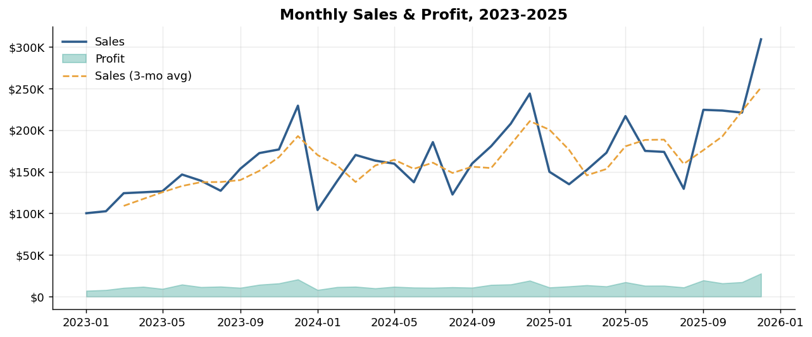
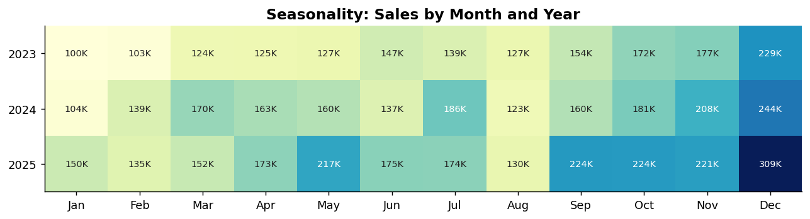
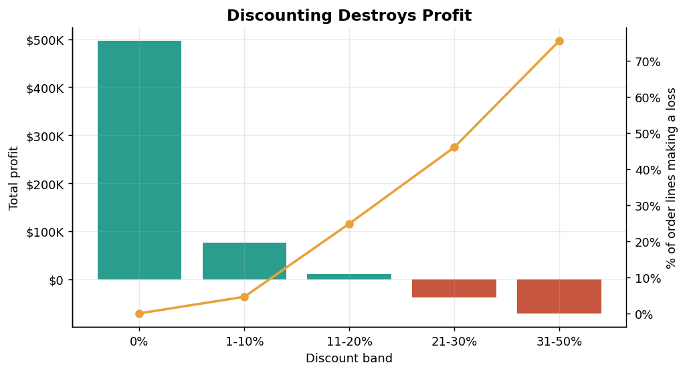
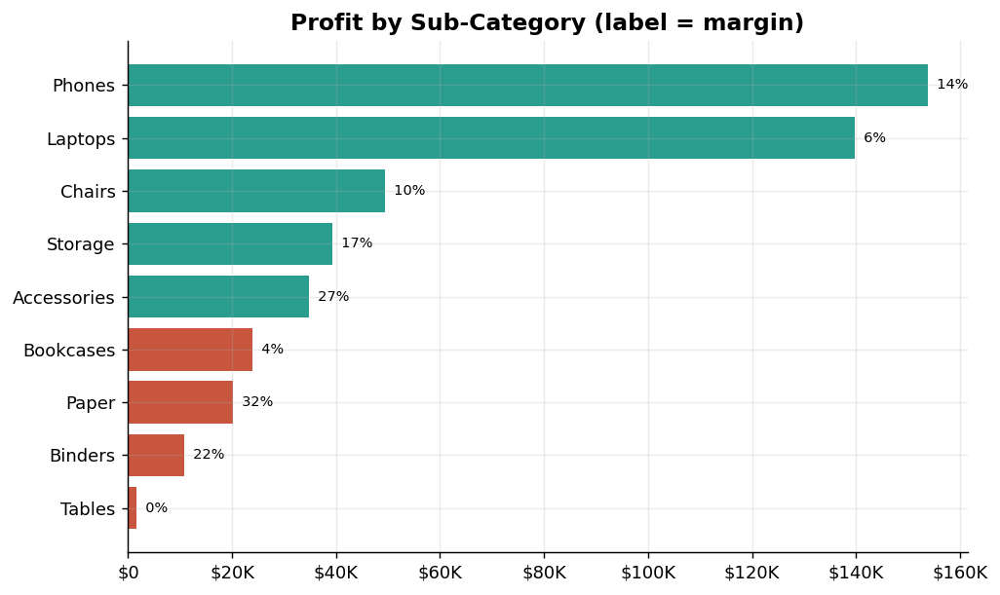
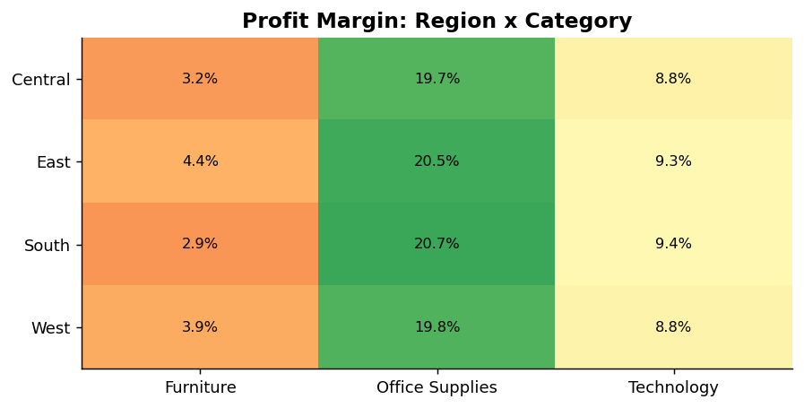
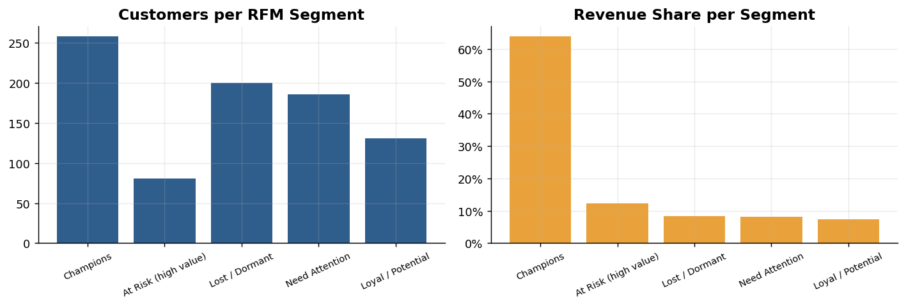
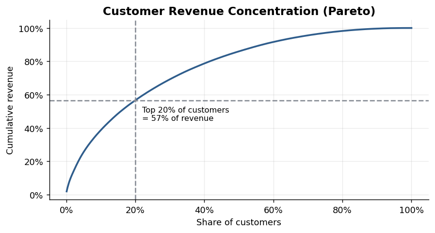

# Retail Sales & Customer Analytics
**Data Analyst Internship Project | Python · SQL · Data Visualization · Streamlit**

> **Data note:** `data/raw_sales.csv` is a **simulated** retail dataset (10,807 order lines, 2023-2025) created by `generate_data.py`, with data-quality problems injected on purpose. The pipeline runs unchanged on any dataset with the same 17 columns (for example the Kaggle "Superstore" data). Replace the CSV and re-run `analysis.py`.

---

## 1. Business Problem
A mid-size retailer sells Technology, Furniture and Office Supplies across four US regions. Sales are growing, but management does not know **where profit is made or lost**. This project answers:

1. How is the business performing, and how seasonal is it?
2. Which products, regions and segments drive (or hurt) profit?
3. What is the impact of discounting on profitability?
4. Who are the most valuable customers, and who is slipping away?

## 2. Executive Summary

| KPI | Value |
|---|---|
| Total sales | **$5.98M** |
| Total profit | **$473.7K** (margin **7.9%**) |
| Orders / customers | 6,000 / 856 |
| Average order value | $997 |
| Average shipping time | 4.8 days |
| Order lines making a loss | **19.1%** (total losses **-$134.7K**) |

**Top findings**
1. **Discounting is the biggest profit leak.** Lines discounted above 20% generate $1.02M of sales but **lose $109K**. Margin falls from 15.9% (no discount) to -6.5% (21-30%) and -16.1% (31-50%).
2. **Growth is not translating into profit.** Sales grew +14.5% in 2024, yet profit fell slightly (margin 8.4% → 7.3%) before recovering to 8.1% in 2025.
3. **Tables are the worst product line.** $967K of sales but only $1.7K of profit (0.2% margin). Tables make money only with no discount (+$40K) and lose money in every discounted band (-$38K combined).
4. **Revenue is concentrated in loyal customers.** Customers with 6+ orders deliver **74%** of revenue, and the top 20% of customers deliver **57%**.
5. **A high-value group is at risk.** 81 previously strong customers have been inactive for ~210 days on average and account for $731K (12%) of lifetime revenue.
6. **Strong seasonality.** October-December are the peak months; December runs ~57% above the average month and November ~22% above, while Jan/Feb and Aug are the weakest (~25% below).

## 3. Approach

| Stage | What was done | File |
|---|---|---|
| Extract | Load 10,807 raw rows × 17 columns | `analysis.py` |
| Clean | Fix 5 categories of data-quality issues (below) | `analysis.py` |
| Engineer | year/month/quarter, shipping days, profit margin, discount bands, loss flag | `analysis.py` |
| SQL | 7 analytical queries on SQLite (CTEs, window functions) | `sql/queries.sql` |
| Analyse | KPIs, seasonality, product/region mix, discount impact, RFM, Pareto | `analysis.py` |
| Visualise | 9 charts + interactive dashboard | `charts/`, `app.py` |

### Data cleaning log
| Issue | Rows affected | Treatment |
|---|---|---|
| Duplicate rows | 46 | Removed |
| Mixed date formats (`YYYY-MM-DD` and `DD/MM/YYYY`) | 324 | Parsed both formats into one datetime type |
| Negative quantities | 12 | Treated as sign errors, converted to absolute value |
| Sales outliers (sales ≠ price × qty × (1 - discount)) | 11 | Recomputed from the formula |
| Missing values (ship mode, name, state, discount) | 594 cells | Customer name/state recovered from the customer's other orders; discount inferred from the sales formula; ship mode set to "Unknown" |
| Inconsistent text (case, spaces) | 7 columns | Trimmed and title-cased |

Result: 10,761 clean rows and **0 missing values**. Each fix uses logic from the data itself rather than blind averages.

## 4. Key Analysis

### 4.1 Trend and seasonality



Sales grew from $1.72M (2023) to $1.97M (+14.5%) to $2.28M (+15.7%). The same Q4 peak repeats every year, so inventory and staffing should be planned around it.

### 4.2 Discounting


| Discount band | Margin | % of lines losing money |
|---|---|---|
| 0% | 15.9% | 0.1% |
| 1-10% | 8.5% | 4.6% |
| 11-20% | 1.1% | 24.9% |
| 21-30% | -6.5% | 46.0% |
| 31-50% | -16.1% | 75.5% |

Discounts up to 10% are healthy. Beyond 20%, most lines lose money.

### 4.3 Products



- **Technology** drives 61% of sales and 69% of profit, but Laptops earn only 5.9% margin.
- **Office Supplies** are small ($349K) but the most profitable (20.2% margin).
- **Furniture** is large but thin (3.7%), dragged down by Tables.
- Regions have similar margins (7.4-8.3%); West is the biggest at $2.15M. Performance differences come from product mix and discounting, not geography.

### 4.4 Customers (RFM segmentation)



| Segment | Customers | Share of revenue |
|---|---|---|
| Champions | 258 | 64% |
| At Risk (high value) | 81 | 12% |
| Lost / Dormant | 200 | 8% |
| Need Attention | 186 | 8% |
| Loyal / Potential | 131 | 7% |

RFM scores each customer 1-4 on Recency, Frequency and Monetary value, then groups them with simple rules (see `analysis.py`).

### 4.5 SQL highlights
`sql/queries.sql` includes year-over-year growth with `LAG()`, customer ranking with `RANK()`, per-region running totals with `SUM() OVER (PARTITION BY ...)`, and repeat-vs-one-time customer analysis with CTEs. Outputs are saved in `reports/`.

## 5. Recommendations

| # | Action | Evidence | Estimated impact |
|---|---|---|---|
| 1 | **Cap discounts at 20%** (require approval above) | Lines >20% discount lose $109K | Removing those losses would raise profit by **up to ~23%** (from $474K to ~$583K) if that volume is not sold at a loss |
| 2 | **Reprice or renegotiate Tables** (and review Bookcases) | 0.2% margin; every discounted band loses money | Protects ~$1M of sales line; even a 5% margin is worth ~$48K |
| 3 | **Win-back campaign for 81 At-Risk customers** | $731K lifetime revenue, ~210 days inactive | Reactivating even 25% restores a meaningful revenue stream |
| 4 | **Protect Champions** with loyalty perks instead of discounts | 258 customers = 64% of revenue | Retains the core without margin loss |
| 5 | **Plan inventory and staffing for Oct-Dec** | December ~57% and November ~22% above the average month | Fewer stock-outs at peak |
| 6 | **Push Office Supplies and Accessories** as add-ons | 20% and 27% margins | Lifts blended margin |

**Assumptions and limits:** the estimate in #1 assumes the discounted lines would simply not be sold; real demand may shift to lower discounts, so treat it as an upper bound. The data is simulated, so findings illustrate the method, not a real company.

## 6. How to Run
```bash
pip install -r requirements.txt
python generate_data.py      # (optional) rebuild the raw dataset
python analysis.py           # clean, analyse, make charts, SQL outputs
streamlit run app.py         # interactive dashboard
```

## 7. Project Structure
```
├── data/            raw_sales.csv, clean_sales.csv, retail.db
├── sql/             queries.sql
├── charts/          9 PNG visuals
├── reports/         summary.json, rfm_customers.csv, SQL result CSVs
├── generate_data.py
├── analysis.py
├── app.py
└── requirements.txt
```

## 8. Skills Demonstrated
Data cleaning and validation · feature engineering · exploratory analysis · SQL (CTEs, window functions) · customer segmentation (RFM) · data storytelling · dashboarding · business recommendations.
